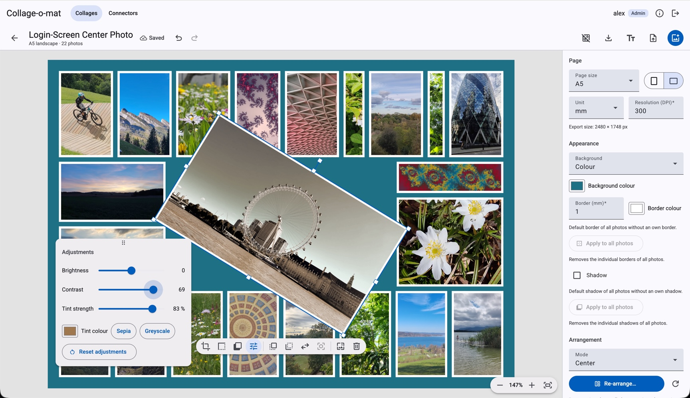

# Collage-o-mat

A Photo collage web app inspired by CollageIt! Pro, in Go / Angular.



## Features

* Import Photos from [an **Immich Server**](https://immich.app/), [**Synology Photos**](https://www.synology.com/dsm/feature/photos) (DSM 7 or newer, incl. albums shared with the account), local files
* Page presets (A5, A4, A3, Letter, 30 × 30 cm) or custom size, DPI setting
* **Arrange photos automatically** in several modes (grid, center mode, random heap, masonry, free placement)
* Settings dialog per arrangement mode, quick re-roll with the same settings
* Random photo order for grid and center mode
* Swap two photos, set the centre photo
* Background (color, gradient, image)
* Individual photo border, border margins, paddings
* Free placement and rotation
* Crop photos inside their frame (pan, zoom)
* Photo adjustments (non-destructive): brightness, contrast, colour tint (e.g. sepia, greyscale)
* Display lengths in mm or px
* **Snap grid** to align photos and texts
* **Text elements** with 16 bundled fonts
* Undo/redo and auto-save
* Duplicate a collage (full, independent copy with all photos and texts)
* Export final image to png, jpg
* **single-binary server**: just deploy one single binary to your server / container!

## Connect an [Immich](https://immich.app/) server

Collageomat can directly import photos from Immich albums. You define an Immich Connector in Collageomat and 
provide the Immich server URL and an API key.

The API Key needs the following permissions:

`asset.read`, `asset.download`, `asset.view`, `album.read`

## Connect a Synology Photos NAS

Collageomat can import photos from **Synology Photos on DSM 7 or newer** (Photo Station / DSM 6 is not
supported). You define a Synology Connector in Collageomat and provide the NAS URL (e.g.
`https://nas.example.com:5001`), an account and its password. Collageomat shows the albums and folders of
the account's **Personal Space** and the albums that other NAS users shared with the account (tab
"Shared with me"; no Shared Space).

* DSM has no API keys: the connector logs in with account + password. 2-factor authentication is not
  supported.
* Use a **dedicated, read-only NAS account** without 2FA that has access to Synology Photos only.
* For a self-signed certificate, the connector has the option "Skip TLS certificate verification".

## Development

Requirements: Docker (with compose), `make`. All tools (Go 1.27, Node 26) run in the dev container.

On the host:

```sh
make dev-up      # build and start the dev container
make dev-shell   # open a shell in the dev container
make dev-down    # stop and remove the dev container
```

In the dev container (`/workspace`):

```sh
make install                         # npm ci + go mod download (first time, after dependency changes)
make user-add USERNAME=alex ADMIN=1  # create a user (password prompt); make user-passwd USERNAME=alex
make backend-run                     # Go backend on :8080
make frontend-serve                  # Angular dev server on :4200, proxies /api to :8080
```

Run `backend-run` and `frontend-serve` in two shells, then open http://localhost:4200.

`make build` builds the frontend, embeds it in the Go binary and writes `bin/collageomat`
(`./bin/collageomat serve` serves the app on http://localhost:8080).

The dev container sets the environment variables. Data (SQLite database, photos) is stored in `data/`.
`make` without a target lists all targets.

## Deploy

The prod image (`docker/Dockerfile`) is one Alpine image with the Go binary and the embedded frontend.
Build it on the host:

```sh
make image     # build for the local platform, tags registry.alexi.ch/collageomat:latest and :<git sha>
make publish   # build linux/amd64 + linux/arm64 and push both tags
```

`make publish` needs `docker login registry.alexi.ch` and a buildx builder that can build multi-platform
images (docker-container driver or containerd image store). The Makefile does not select a builder.

Run the image:

```sh
docker run -d --name collageomat -p 8080:8080 \
  -e COLLAGEOMAT_SECRET=<secret> \
  -v collageomat-data:/data \
  registry.alexi.ch/collageomat:latest
docker exec -it collageomat /app/collageomat user add --username alex --admin
```

| Variable | Default | Meaning |
|---|---|---|
| `COLLAGEOMAT_SECRET` | — (required) | Key for the encrypted connector API keys and passwords. Do not change it later. |
| `COLLAGEOMAT_DATA_DIR` | `/data` | SQLite database and photos |
| `COLLAGEOMAT_LISTEN` | `:8080` | Listen address |
| `COLLAGEOMAT_COOKIE_SECURE` | `true` | Set `false` only without HTTPS |
| `COLLAGEOMAT_COOKIE_NAME` | `collageomat_session` | Name of the session cookie |

The container runs as uid/gid 10001. For a bind mount on a Linux host, `chown 10001:10001 <dir>` first.
